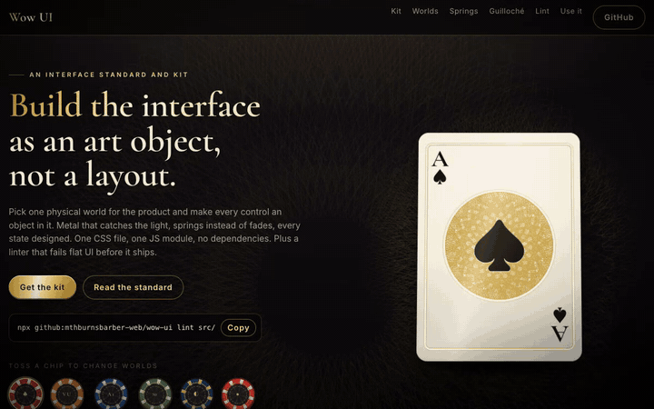
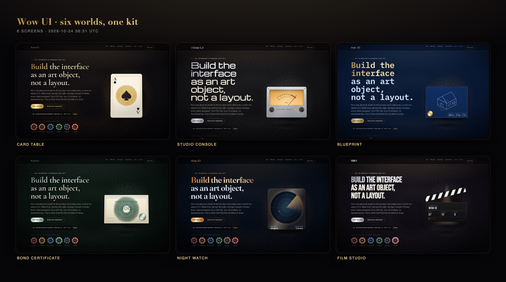
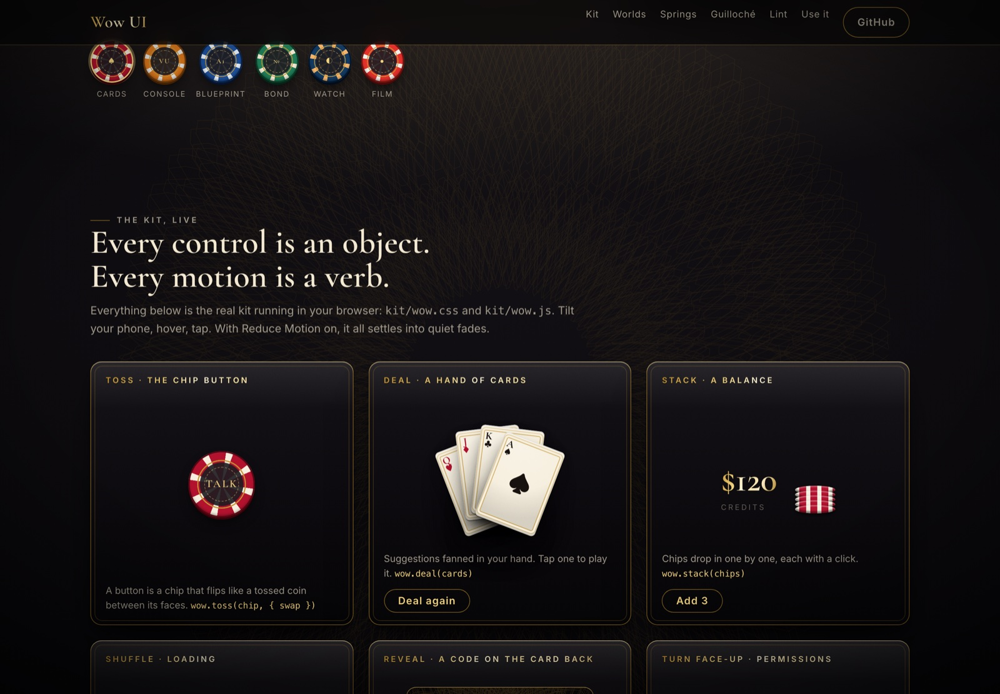

# Wow UI

Build the interface as an art object, not a layout.

A written standard for interfaces that feel like real objects, the CSS and JavaScript kit that implements it, a linter that fails flat UI, and a contact-sheet tool for judging every screen as one artwork. Zero dependencies.

**[Live demo](https://mthburnsbarber-web.github.io/wow-ui/demo/)** · [The standard](STANDARD.md) · [Install as a skill for Claude Code or Codex](#for-your-ai)

[](https://mthburnsbarber-web.github.io/wow-ui/demo/)

## Why

Ask an AI for a screen and you get the same screen every time: grey-bordered cards, a spinner, a fade, a yellow "gold". It works and nobody remembers it.

This standard makes one demand before any code is written: pick one physical world for the product and make every control an object in it. On a card table, a button is a casino chip that flips like a tossed coin. Suggestions are a hand of cards. Loading is a riffle shuffle. An error is the Joker, with the exact reason and the fix. Metal is a three-stop gradient that catches the light, never flat yellow. Nothing simply fades in.

The prose alone wasn't enough. Every session re-invented gold leaf, grain and spring easing from scratch, and nothing checked the banned list. So the standard now ships with the parts:

- **A kit.** `kit/wow.css` holds the material system as tokens: lacquer, metal, engraved double rules, key light, vignette, grain. `kit/wow.js` holds the physics: exact springs, guilloché, gyroscope tilt, haptics and motion verbs. Together they are about 50 KB unminified, with no build step.
- **Six worlds.** Card table, studio console, blueprint, bond certificate, night watch and film studio, as token sets. Put `data-wow-world` on any element and every surface inside changes.
- **A linter.** `wow-ui lint` fails the build on stock spinners, plain fades, linear easing, flat grey borders, flat yellow gold, controls that do nothing, icon buttons with no label, and motion with no Reduce Motion fallback. It reads CSS, HTML, JSX, Vue, Svelte and SwiftUI.
- **A contact sheet.** `wow-ui sheet` photographs every screen with the Chrome you already have and lays them out on one page, so you see the product the way a stranger does.



*Made with `wow-ui sheet`. Same page, same markup, six token sets.*

## The linter

```
$ npx github:mthburnsbarber-web/wow-ui lint examples/flat
examples/flat/SettingsView.swift:13:13  warn   system-segmented   Unstyled segmented control. Make it an object from your world.
examples/flat/SettingsView.swift:15:26  error  stock-spinner      Stock spinner. Make loading an object from your world.
examples/flat/SettingsView.swift:17:13  error  silent-control     Control that does nothing. Say why it can't act and offer the fix.
examples/flat/SettingsView.swift:18:17  error  flat-gold          Flat yellow gold. Metal is a three-stop gradient: var(--wow-metal).
examples/flat/SettingsView.swift:20:9   error  plain-fade         Plain fade. Give it a verb with a spring; fades are for Reduce Motion only.
examples/flat/SettingsView.swift:20:9   error  no-reduced-motion  Motion with no Reduce Motion fallback in any scanned file.
examples/flat/SettingsView.swift:21:9   error  linear-easing      Linear easing on one-shot motion. Use a spring: var(--wow-spring-*).
examples/flat/styles.css:3:3            error  flat-grey-border   Flat grey border. Use an engraved rule: .wow-plate, var(--wow-rule).
examples/flat/styles.css:9:3            error  plain-fade         Plain fade. Give it a verb with a spring; fades are for Reduce Motion only.
examples/flat/styles.css:13:3           error  linear-easing      Linear easing on one-shot motion. Use a spring: var(--wow-spring-*).
examples/flat/styles.css:16:1           error  plain-fade         Plain fade. Give it a verb with a spring; fades are for Reduce Motion only.
examples/flat/styles.css:22:3           error  flat-gold          Flat yellow gold. Metal is a three-stop gradient: var(--wow-metal).
examples/flat/Toolbar.jsx:3:10          error  flat-grey-border   Flat grey border. Use an engraved rule: .wow-plate, var(--wow-rule).
examples/flat/Toolbar.jsx:4:24          error  stock-spinner      Stock spinner. Make loading an object from your world.
examples/flat/Toolbar.jsx:6:15          error  silent-control     Control that does nothing. Say why it can't act and offer the fix.
examples/flat/Toolbar.jsx:7:7           error  unlabeled-control  No accessible label. Every object needs a name.
examples/flat/Toolbar.jsx:8:7           error  silent-control     Control that does nothing. Say why it can't act and offer the fix.

17 problems (16 errors, 1 warning) in 3 files
```

The same file has a marquee on `linear infinite`. That passes: linear is right for a continuous loop. Fades inside `@media (prefers-reduced-motion: reduce)` pass too, because that is where fades belong. Comments are blanked before matching, so a comment that says "no linear easing" is not a finding. The kit and the demo pass their own linter, and CI checks that on every push.

| Rule | Fails on |
|---|---|
| `stock-spinner` | `spinner-border`, `animate-spin`, `<CircularProgress>`, `<ActivityIndicator>`, react-spinners, an indeterminate `<progress>`, a bare SwiftUI `ProgressView()` |
| `plain-fade` | a transition on `opacity` alone, opacity-only `@keyframes`, Tailwind `transition-opacity`, SwiftUI `.transition(.opacity)` |
| `linear-easing` | `linear` on a one-shot transition or animation, `easing: 'linear'`, Tailwind `ease-linear`, SwiftUI `.linear` without `repeatForever` |
| `flat-grey-border` | `1px solid #e5e7eb` and its cousins, Tailwind `border-gray-200`, SwiftUI `.border(.gray)` |
| `flat-gold` | `gold`, `#ffd700`, SwiftUI `.yellow` used as a colour |
| `silent-control` | `onClick={() => {}}`, `href="#"` with no handler, SwiftUI `Button("…") {}` |
| `unlabeled-control` | an icon-only `<button>` with no `aria-label`, an `` with no `alt`, a SwiftUI image button with no `accessibilityLabel` |
| `no-reduced-motion` | motion anywhere in the scanned files with no `prefers-reduced-motion`, `useReducedMotion` or `accessibilityReduceMotion` |
| `system-segmented` (warn) | an unstyled SwiftUI segmented picker or `UISegmentedControl` |

Suppress one finding with a reason. A suppression without a reason is itself an error:

```css
/* wow-lint-disable-next-line linear-easing -- ticker scrolls at a constant speed */
```

Lower or turn off a rule for a project in `.wowlintrc.json`:

```json
{ "rules": { "flat-grey-border": "warn" }, "ignore": ["vendor/**"] }
```

Options: `--json`, `--max-warnings n`, `--config file`, `--rules`. Exit codes: `0` clean, `1` findings, `2` usage error.

## The kit

```html
<link rel="stylesheet" href="https://cdn.jsdelivr.net/gh/mthburnsbarber-web/wow-ui@v1.0.0/kit/wow.css">
<link rel="stylesheet" href="https://cdn.jsdelivr.net/gh/mthburnsbarber-web/wow-ui@v1.0.0/worlds/worlds.css">

<body class="wow-scene" data-wow-world="card-table">
  <div data-wow-tilt>
    <div class="wow-card wow-tilt wow-foil wow-glint">…</div>
  </div>
  <button class="wow-chip" aria-label="Talk"><span>Talk</span></button>
</body>

<script type="module">
  import * as wow from 'https://cdn.jsdelivr.net/gh/mthburnsbarber-web/wow-ui@v1.0.0/kit/wow.js';
  wow.auto();                                    // grain, springs, data-wow-* wiring
  chip.onclick = () => wow.toss(chip, { swap: () => (label.textContent = 'Send') });
</script>
```

Or copy `kit/` and `worlds/` into your project. There is nothing to install.



**Materials** (CSS): `.wow-scene` (lacquer, key light, vignette, grain), `.wow-leaf` (gold leaf type), `.wow-metal`, `.wow-plate` (engraved double rule), `.wow-felt`, `.wow-rule`, `.wow-foil`, `.wow-glint`, `.wow-holo`, `.wow-rosette`.

**Objects** (CSS): `.wow-card`, `.wow-back`, `.wow-flip` with `.wow-face`, `.wow-chip`, `.wow-stack` with `.wow-chip-disc`, `.wow-button`, `.wow-riffle`, `.wow-joker`, `.wow-code`. Every control has a visible focus ring in the world's metal.

**Physics** (JS):

| Function | Does |
|---|---|
| `spring({ response, dampingFraction, velocity })` | Solves a damped spring exactly and returns `{ easing, duration, overshoot }`, where `easing` is a CSS `linear()` string. Same parameters as SwiftUI's `.spring(response:dampingFraction:)`. |
| `springs.snappy / deal / flip / toss / settle` | The named springs. They are baked into `wow.css` as `--wow-spring-*` and `--wow-dur-*`, so CSS gets real springs without JavaScript. |
| `guilloche(opts)`, `guillocheBand(opts)` | Banknote line work as deterministic SVG. |
| `tilt(el, { max })` | Pointer and gyroscope tilt, low-pass filtered. Writes `--wow-rx/ry` (rotation) and `--wow-mx/my` (light position). On iOS the first tap asks for motion permission. |
| `grain()` | Paints a noise tile at the screen's real pixel density, so a 3× phone gets 3× grain. |
| `deal`, `flip`, `toss`, `stack`, `play`, `shake`, `burst` | The motion verbs. Each runs on a spring and fires a matching haptic. |
| `haptic('tick' \| 'select' \| 'tap' \| 'land' \| 'success' \| 'error')` | Vibration where the browser has it and the person has interacted with the page. Does nothing elsewhere and never throws. |
| `reducedMotion()`, `auto()`, `publishSprings()` | Reduce Motion check, page wiring, spring custom properties. |

Under Reduce Motion every verb becomes a short cross-fade in place, and every looping animation stops.

From the command line:

```
$ npx github:mthburnsbarber-web/wow-ui spring --response 0.62 --damping 0.72
transition: transform 750ms linear(0, 0.0131, 0.0484, 0.1001, 0.1633, 0.234, 0.3089, 0.385, …, 1);
/* settles in 750 ms, overshoot 3.8% */

$ npx github:mthburnsbarber-web/wow-ui guilloche --lobes 24 --strands 40 --out rosette.svg
```

## The contact sheet

```
npx github:mthburnsbarber-web/wow-ui sheet \
  "Home=http://localhost:3000/" "Sign in=http://localhost:3000/login" "Empty=http://localhost:3000/inbox?empty=1" \
  --width 390 --height 844 --dpr 2 --out before.png
```

It uses the Chrome, Chromium, Edge or Brave already on your machine, or the one at `CHROME_PATH`. Take one before the change and one after. Look at them side by side.

Options: `--out`, `--width`, `--height`, `--cols`, `--wait ms` (time for the page to settle), `--dpr`, `--title`, `--html` (also keep the sheet as HTML).

## For your AI

The standard is written to be pasted at the top of any UI task. It also installs as a skill for Claude Code and Codex: every UI task loads the standard, uses the kit, and runs the linter and the contact sheet before calling the work done.

```
git clone https://github.com/mthburnsbarber-web/wow-ui ~/.claude/skills/wow-ui   # Claude Code
git clone https://github.com/mthburnsbarber-web/wow-ui ~/.codex/skills/wow-ui    # Codex
```

For Cursor and other agents, add one line to `AGENTS.md`:

```
Before any UI work, read and follow STANDARD.md from github.com/mthburnsbarber-web/wow-ui, then run `npx github:mthburnsbarber-web/wow-ui lint` on the changed files.
```

## What it doesn't do

- It doesn't make a screen good. The linter catches what a machine can see. Whether your world is right, and whether the hero object is any good, is the contact sheet and your own eyes on a real device.
- It doesn't ship native components. The SwiftUI recipes are in the standard, and the springs use the same numbers on both platforms. The kit itself is web.
- The linter matches patterns. It does not build a full AST, so dynamic class names and computed styles can slip past it. It is strict about the common cases and quiet about what it can't judge.
- The demo's sample data (a balance, door sensors) is labelled as sample data. The kit has no data of its own.

## License

MIT. Made by [Michael Barber](https://blacklabeltec.com/michael-barber) at [Black Label Tec](https://blacklabeltec.com/).
